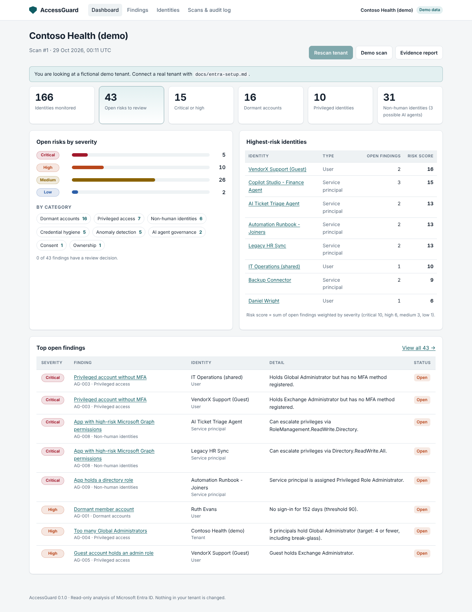

# AccessGuard

**Know who has access to your Microsoft 365 tenant, find risky permissions and produce audit-ready evidence — without spending hours doing it manually.**

AccessGuard is a read-only identity security and access governance tool for **Microsoft Entra ID**. It connects through Microsoft Graph with read-only application permissions, flags the access risks that matter most (dormant accounts, admins without MFA, over-privileged apps and AI agents, risky consent grants, credential hygiene), lets reviewers record a decision against every finding, and exports an evidence pack for IT managers and auditors.



> The screenshot shows the built-in **demo tenant** — every name in it is fictional.

---

## Features

- **Read-only by design.** The Graph client only implements `GET`, refuses to send its token anywhere except `graph.microsoft.com`, and warns you if its own app registration has more permissions than it needs.
- **15 risk rules** across dormant accounts, privileged access, non-human identities, credential hygiene, consent and AI agent governance — each with *why it matters* and *how to fix it*.
- **Anomaly detection for non-human identities.** Every service principal gets a privilege score from its Graph permissions, tenant-wide consent and directory roles; scores are compared with the tenant's peer group using a robust (median/MAD) z-score to surface identities that are out of line.
- **AI agent visibility.** Service principals that look like AI agents or bots (Copilot Studio agents, GPT/LLM integrations and so on) are flagged by a configurable heuristic, and agents without an accountable owner are raised as findings.
- **Review workflow with an audit trail.** Acknowledge, remediate, accept risk (with mandatory justification) or mark false positive. Decisions carry across scans; anything marked *remediated* reopens automatically if it is detected again. Every decision is written to an append-only log.
- **Evidence exports.** A printable HTML evidence pack (print to PDF), plus CSV and JSON.
- **Graceful degradation.** Missing a licence or permission? The scan still runs, records what it could not see, and lists the checks it skipped instead of reporting false negatives.
- **Demo mode** with a realistic fictional tenant, so you can explore the product without connecting anything.

## Quick start (demo, no tenant needed)

Requires Python 3.10+.

```bash
git clone https://github.com/<your-username>/accessguard.git
cd accessguard
python -m venv .venv
source .venv/bin/activate        # Windows: .venv\Scripts\activate
pip install -e .

accessguard serve --demo         # open http://127.0.0.1:8000
```

## Connect a real tenant

1. Create a read-only app registration — follow **[docs/entra-setup.md](docs/entra-setup.md)** (portal steps or the included PowerShell script).
2. Copy `.env.example` to `.env` and fill in `AZURE_TENANT_ID`, `AZURE_CLIENT_ID` and either `AZURE_CLIENT_SECRET` or a certificate.
3. Check the permissions, then scan:

```bash
accessguard check-permissions
accessguard scan
accessguard serve
```

### Permissions used (all read-only application permissions)

| Microsoft Graph permission | Used for |
|---|---|
| `User.Read.All` | Users, account status and hybrid-sync flag |
| `Directory.Read.All` | Organisation details, tenant-wide consent grants, directory objects |
| `AuditLog.Read.All` | Sign-in activity (dormant accounts) and the MFA registration report |
| `RoleManagement.Read.Directory` | Directory role definitions and assignments |
| `Application.Read.All` | App registrations, credentials, owners, service principals and app permissions |
| `UserAuthenticationMethod.Read.All` | MFA registration details |

Sign-in activity and MFA registration details require **Entra ID P1 or P2**. Without them, the dependent checks are skipped and the report says so.

## Rules

| ID | Rule | Default severity | Category |
|---|---|---|---|
| AG-001 | Dormant member account (high if it holds a privileged role) | Medium | Dormant accounts |
| AG-002 | Dormant guest account | Medium | Dormant accounts |
| AG-003 | Privileged account without MFA | Critical | Privileged access |
| AG-004 | Too many Global Administrators | High | Privileged access |
| AG-005 | Guest account holds an admin role | High | Privileged access |
| AG-006 | Admin role on an on-premises synced account | Medium | Privileged access |
| AG-007 | Disabled account still holds roles | Low | Privileged access |
| AG-008 | App with high-risk Microsoft Graph permissions | Critical / High | Non-human identities |
| AG-009 | App holds a directory role | High | Non-human identities |
| AG-010 | App credential expired or expiring | Medium / Low | Credential hygiene |
| AG-011 | Long-lived client secret | Medium | Credential hygiene |
| AG-012 | App registration has no owner | Medium | Ownership |
| AG-013 | Tenant-wide consent to high-risk delegated permissions | High | Consent |
| AG-014 | AI agent with no accountable owner | High | AI agent governance |
| AG-100 | Non-human identity over-privileged compared with its peers | Medium | Anomaly detection |

Run `accessguard rules` for the live list. Thresholds (dormancy days, secret lifetime, Global Admin limit, anomaly threshold, AI agent keywords) are configurable in `.env`.

## Command line

```text
accessguard scan [--demo] [--fail-on high]    Scan and store results (exit code 2 if open findings ≥ severity)
accessguard serve [--host] [--port] [--demo]  Start the dashboard (localhost by default)
accessguard report --format html|csv|json     Export the latest scan as evidence
accessguard check-permissions                 Show the Graph permissions the app actually holds
accessguard rules                             List the rules
```

`--fail-on` makes AccessGuard usable in a scheduled pipeline: fail the job when a new critical or high finding appears.

## Run with Docker

```bash
cp .env.example .env              # set ACCESSGUARD_UI_PASSWORD — required when running in a container
docker compose up --build         # http://127.0.0.1:8000
```

The container runs as a non-root user, stores data in the `accessguard-data` volume and is published on localhost only.

## Security model

- **No write access, ever.** There is no code path that changes the tenant. The scanner checks its own token and warns about unnecessary permissions.
- **Least-privilege credentials.** Prefer a certificate over a client secret; keep secrets short-lived. `.env`, keys and the `data/` folder are git-ignored.
- **Local data is sensitive.** Snapshots contain your directory data. They are written to `data/` with owner-only permissions; protect that folder like any other identity export.
- **Web UI hardening.** Binds to `127.0.0.1` by default and refuses a non-local address unless a password is set; HTTP Basic auth, CSRF tokens on every form, a strict Content-Security-Policy, no third-party scripts, and CSV exports are protected against formula injection. Put it behind your SSO reverse proxy (for example Entra application proxy) if you share it with a team.

See [SECURITY.md](SECURITY.md) for how to report a vulnerability.

## Project layout

```text
accessguard/
  graph_client.py   Read-only Microsoft Graph client (MSAL, paging, throttling)
  collector.py      Builds a tenant snapshot from Graph, degrading gracefully
  rules.py          Risk rules (add a rule with the @rule decorator)
  anomaly.py        Privilege scoring and robust z-score outlier detection
  engine.py         Runs rules, scores identities, summarises results
  storage.py        SQLite scan history, review decisions and audit log
  report.py         HTML / CSV / JSON evidence exports
  web/              FastAPI dashboard, templates and styles
  demo_data.py      Fictional tenant used for demos and tests
tests/              pytest suite (no network access needed)
docs/               Tenant setup guide and images
scripts/            PowerShell helper to create the read-only app registration
```

## Development

```bash
pip install -e ".[dev]"
pytest
ruff check .
```

## Roadmap

- Privileged Identity Management: flag permanent assignments where eligible (just-in-time) access is available
- Conditional Access coverage: admins and agents not covered by an MFA or device policy
- Group-based access and role-assignable groups
- Service principal sign-in activity, to find unused apps and agents
- Scheduled scans and email/Teams alerts on new critical findings
- Multi-tenant mode for managed service providers
- First-class support for Microsoft Entra Agent ID objects as they become generally available

## Disclaimer

AccessGuard highlights potential risks from a point-in-time snapshot. Findings should be validated before remediation, and the tool does not replace a professional security assessment. Licensed under the terms in [LICENSE](LICENSE).
